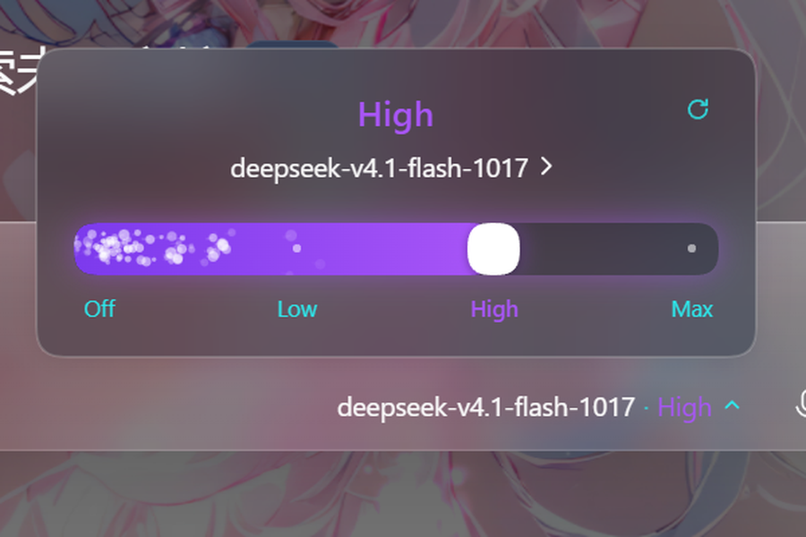
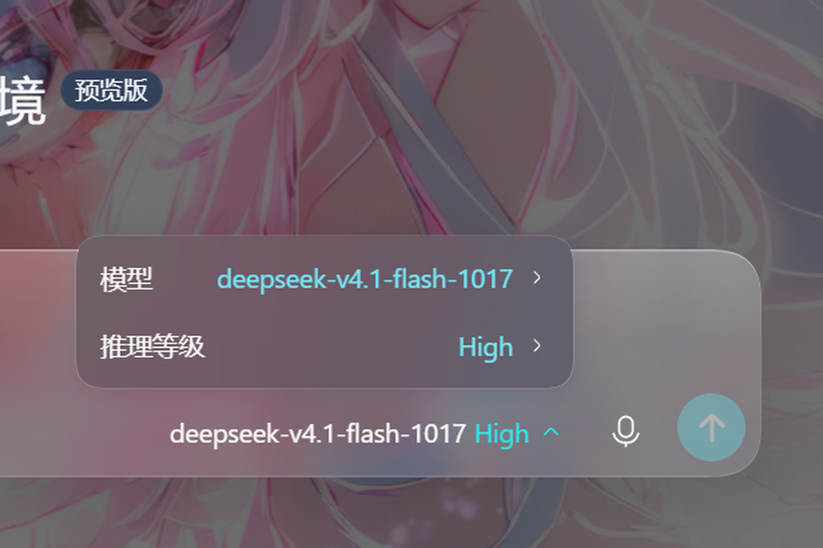
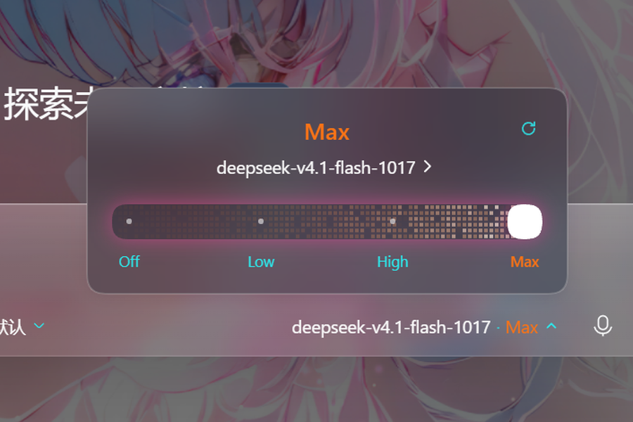
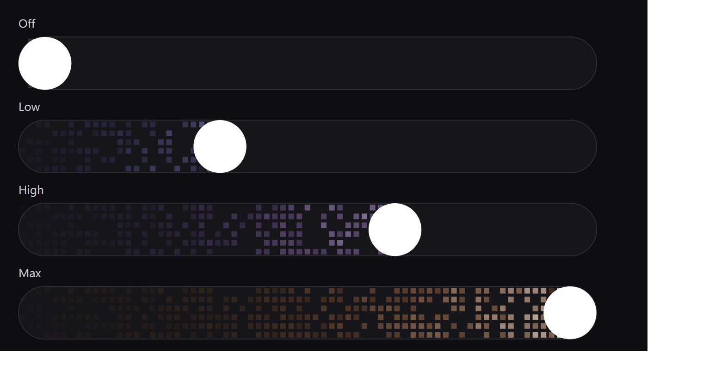
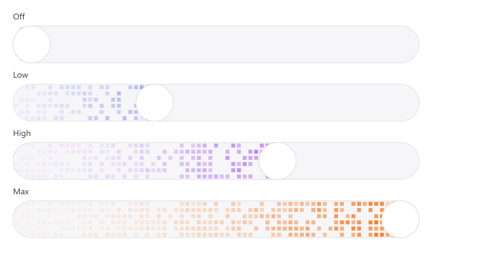

# dsh-thinking-slider

[](https://awesome-dsh-plugin.com)

把 DeepSeek Harness（DSH）composer 里的**模型选择器**换成「模型 + 推理强度」：
平时显示 `模型名 · 等级`，点开是一张卡片 —— 上面是模型列表入口，下面是带**渐变与粒子**的强度滑块。

*An opinionated model + reasoning-effort picker for the DSH composer, with a gradient particle rail.*



## 它做什么

- **关闭态**：正常的一行文字 `deepseek-flash · Max`，不占地方
- **点开**：卡片里大字显示当前等级，`模型名 ›` 可切模型，下面一条厚滑块
- **拖滑块**：即时切换推理强度；视觉随等级变化（见下方三种模式）
- **键盘**：`←/→`、`Home/End` 切换，`Esc` 关闭
- **降级**：模型没有推理等级时只显示模型名，不出现滑块（不会给你一个假的控件）

等级**不写死在插件里** —— 它读 DSH 上报的 `model.reasoning.efforts`，
所以任何在配置里声明了 `reasoningEfforts` 的供应商路由都会自动出现在滑块上。

## 三种模式

在 **设置 → 通用 → 推理滑块** 里切换。模式存在浏览器本地（localStorage），
切换即时生效，不需要重启。

| 模式 | 效果 |
| --- | --- |
| **官方** | 插件完全不注册座位，交还 DSH 官方的模型选择器原样 |
| **粒子** | 轨道渐变 + 内部漂浮粒子，等级越高越密 |
| **能量充能** | 深色轨道上的点阵充能场，前沿从左扫入旋钮，最高档持续燃烧 |

| 官方 | 粒子 | 能量充能 |
| --- | --- | --- |
|  |  |  |

设置行**独立于座位注册**，所以即使选了「官方」也随时能切回来 —— 不会把自己锁在外面。

能量模式是 canvas 2D 的逐格衰减模拟（不是 WebGL，也没有引入依赖）：
每格有自己的随机相位与速度，前沿扫过时依次点亮，靠近旋钮的格子落定成
「热核 + 曳光」，最高档则保持长记忆让整条轨道持续燃烧；中间档落定后
**主动停掉渲染循环**，静止不烧 CPU。

**浅色 / 深色是两套分开的配色**：深色下格子越热越漂向白色（靠近旋钮白热），
浅色下**保持本色饱和度、靠对比度表达等级** —— 浅色轨道本身已接近白色，
再往白漂就等于把格子从视野里抹掉。配色跟随 `data-ds-dark-theme` 实时切换，
不用重开卡片。

| 深色 | 浅色 |
| --- | --- |
|  |  |

## 与 DSH 原生能力的关系

从 **DSH 0.2.2** 起，这两件事已经由内核自己做了，**本插件不再重复**：

- **声明等级**：**设置 → 模型** 添加自定义代理商时，每个模型都能选推理等级
  （内核按协议校验，例如 Gemini 只接受 `minimal`/`low`/`medium`/`high`）
- **选择等级**：模型菜单里已有等级子菜单（含「供应商默认」）

所以 0.4.0 起本插件**只做外观**：三种视觉模式和卡片排版。等级本身仍走官方接口，
插件不改动 `reasoningEfforts` 配置，也不会替你写任何模型设置 —— 缺等级请去
**设置 → 模型** 补。

如果你更想要官方那套控件，把模式切成「官方」即可，插件随即完全不注册座位。

## 与装饰类插件的兼容性

壁纸 / 玻璃 / 主题美化类插件会**改写主题 token**，甚至**接管弹窗**。这两件事都不会报错，
但会让卡片出现"渗色"或"分层"。已经处理好的两处，以及排查顺序：

**1. 背景 token 被改成玻璃**

这类插件常做：

```css
--dsw-alias-bg-base: transparent !important;
--dsw-alias-bg-layer-1/2/3: color-mix(in srgb, #fff 6%, transparent);
```

只靠这些 token 拼出来的表面就会透光，背后的壁纸内容显出来像一条横向色带。

本插件的处理：

- 滑块轨道与设置里的分段控件**自带不透明底色**（深 `#24252b` / 浅 `#e8eaf0`），主题色叠在它上面
- 卡片在 `<body data-we-wallpaper>` 存在时**转为不透明**（深 `#2a2b31` / 浅 `#f2f3f7`）并关闭 backdrop 模糊；
  没有壁纸时仍保持 DSH 的磨砂材质

**2. 弹窗被装饰插件接管**

有的插件按 `[role="dialog"]` 给弹窗垫一块"可读性底板"，底板比卡片大一点，就会从卡片边缘露出来
成一条浅色竖带（而且**只在开了该插件时**出现，关掉就正常 —— 这是最快的判定方法）。

本插件的处理：卡片带 `data-we-surface-runtime`。这个属性是壁纸插件自己留的排除标记
（它的选择器里写着 `:not([data-we-surface-runtime])`，意为"这个表面自己管外观"），
带上之后不会再被重新皮肤化。没装该插件时该属性无副作用。

**排查顺序**：先确认是不是"关掉美化插件就正常"；是的话先看背景 token（`background` 是否只有
`var(...)`），再看是不是被 `[role="dialog"]` 之类的选择器接管了。改完用 DevTools 的
Styles 面板确认自己的规则**在最后生效**。

## 要求

- DSH Desktop 或 `dsh web`，内核 **0.2.x**（开发时验证于 `0.2.0-rc.1` / `0.2.0-rc.2`）
- 无第三方依赖：只用 DSH 自带的 `react` / `react/jsx-runtime` / `react-dom`

插件**没有声明 `peerDependencies`**，所以不会被 DSH 的版本门禁整包跳过；
代价是版本兼容由你自己判断，升级 DSH 后如果 UI 槽位变了可能失效。

## 安装

```bash
dsh plugin --profile desktop add github:MuFeng262/dsh-thinking-slider
```

装完**完全退出 DSH Desktop 再打开**（客户端插件在启动时组合加载）。

> 如果你的 profile 名不是 `desktop`，把 `--profile desktop` 换成实际名字。
> 插件管理器里添加同一条 `github:MuFeng262/dsh-thinking-slider` 也可以。

<details>
<summary>手动安装（命令不可用时）</summary>

1. 克隆到插件源码目录：

   ```bash
   git clone https://github.com/MuFeng262/dsh-thinking-slider %USERPROFILE%\.dsh\plugins-src\dsh-thinking-slider
   ```

2. 把 `node_modules\dsh-thinking-slider` 做成指向它的**目录联结（junction）**：

   ```powershell
   New-Item -ItemType Junction `
     -Path "$env:USERPROFILE\.dsh\profiles\desktop\node_modules\dsh-thinking-slider" `
     -Target "$env:USERPROFILE\.dsh\plugins-src\dsh-thinking-slider"
   ```

3. 在 `%USERPROFILE%\.dsh\profiles\desktop\package.json` 里加两处：

   ```jsonc
   {
     "dependencies": {
       "dsh-thinking-slider": "file:../../plugins-src/dsh-thinking-slider"
     },
     "dsh": {
       "profile": {
         "bundles": [
           "dsh-thinking-slider"        // ← 加进这个数组
         ]
       }
     }
   }
   ```

4. 重启 DSH Desktop。
</details>

## 让自定义模型也有推理等级

**档位不在插件里。** 插件是通用的，档位来自模型自己声明的能力。

**DSH 0.2.2 起**，直接去 **设置 → 模型** 给自定义代理商的每个模型选等级即可，
内核会按协议校验可用档位。下面的手写方式只在**旧版 DSH**、或者你想一次性批量改配置时还有用：

```yaml
- id: llm-pi-ai
  name: "@deepseek-ai/dsh-llm-pi-ai"
  config:
    providers:
      your-gateway:
        displayName: 你的中转商
        apiKeyEnv: YOUR_API_KEY
        api: openai-completions
        baseURL: https://your-gateway.example/v1
        models:
          - id: some-model
            name: some-model
            reasoningEfforts:      # ← 关键：每个模型单独写
              off: none
              low: low
              high: high
              max: max
```

几点注意：

- 右边那些值是**原样发到网关的拼写**，不是 DSH 的枚举。不同中转商认的词不一样，
  填错可能 400 —— 建议先只给一个模型加上试。
- 键名（`off` / `minimal` / `low` / `medium` / `high` / `xhigh` / `max`）决定了滑块上有几档。
- 省略 `reasoningEfforts` 时，DSH 只会按**模型 id** 去查内置目录；
  自定义模型名查不到 → 该模型就没有等级。
- `reasoningEfforts: false` 可以显式声明为「非推理模型」。

## 卸载

```bash
dsh plugin --profile desktop remove dsh-thinking-slider
```

手动装的，要删三处：`node_modules\dsh-thinking-slider`、
`package.json` 的 `dependencies` 条目、以及 `dsh.profile.bundles` 里的同名项。
**只删 dependencies 不够** —— bundles 里的条目不清掉，插件开机仍会被加载。

## 开发

```bash
git clone https://github.com/MuFeng262/dsh-thinking-slider
cd dsh-thinking-slider
node test/smoke.mjs      # 106 项行为测试，零依赖，不需要 DSH
```

`test/smoke.mjs` 自带一个迷你 React 运行时（hooks 槽位、类组件与错误边界、
跨渲染的 DOM 节点身份、真实执行的 effect 与 cleanup），所以
「节点重挂后动画有没有重新绑定」这类问题是可以断言的，不需要开浏览器。

发布新版本见 [RELEASING.md](RELEASING.md)：Release 说明**必须中英双语**，
release 附件与 npm 包用同一个 tarball（保证字节一致）。

## 许可

MIT
